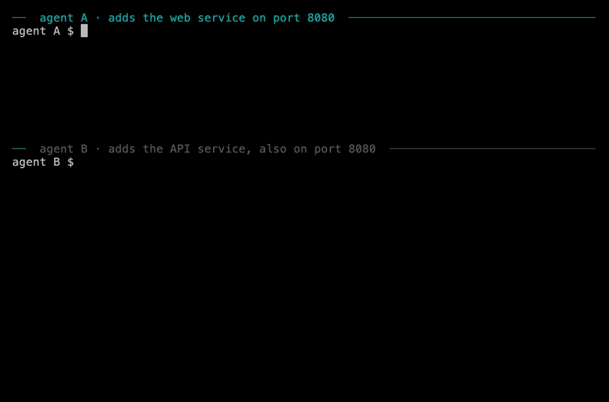

<h1 align="center">bay</h1>

<p align="center">
  <strong>Many agents. Git. No merge mess.</strong><br>
  Your agents submit once. bay merges exactly what was checked.
</p>

<p align="center">
  <a href="https://getbay.io">Website</a> ·
  <a href="https://getbay.io/docs">Docs</a> ·
  <a href="https://getbay.io/docs/install">Install</a> ·
  <a href="https://getbay.io/docs/quickstart">Quickstart</a> ·
  <a href="https://getbay.io/docs/changelog">Changelog</a> ·
  <a href="https://getbay.io/blog">Blog</a>
</p>

<p align="center">
  <a href="LICENSE"></a>
  
  <a href="https://github.com/gudjon/bay/releases"></a>
  <a href="https://github.com/gudjon/bay/stargazers"></a>
</p>

<p align="center">
  <picture>
    <source media="(prefers-color-scheme: dark)" srcset="docs/assets/how-it-works-dark.svg">
    
  </picture>
</p>

---

Git is fine. The workflow around it was built for people. Run several coding agents in one codebase,
often in the same files, and branches go stale, merges collide and main breaks, while someone watches
every merge. bay is a free, MIT-licensed command that takes that work off your agents and your team.
An agent opens a change, edits, and submits it once. bay combines it with the latest main, runs your
checks on that exact result, and merges only what passed. An executor finishes the merge, so the agent
can start its next task. Your repository stays an ordinary Git repository, on the host you already have.

<p align="center">
  
</p>

```sh
bay start CARD-123 --paths src/api   # a view of only the files this change needs
# … the agent edits …
bay land                             # submit: bay checks the exact result and merges it; returns at once
bay status                           # what every change is doing, what passed, and why it waits
bay status --fleet                   # every machine and session on the repository
bay watch                            # what changed that affects my work
bay start c7k2m4qa                   # pick a change up again, on the newest main
bay abandon                          # give the change up; another agent may adopt it
bay talk <agent> "<what>" …          # ask another agent for one change, decision or check
bay undo c7k2m4qa                    # a new change that undoes one merge; history stays
bay help                             # every command and flag on one page
```

People who are not developers use `bay save`, `bay waiting` and `bay approve`, usually through their
agent. Whoever runs bay for the team uses `bay enrol`, `bay prune` and `bay doctor`. See the
[CLI reference](https://getbay.io/docs/cli).

bay's commands call main `trunk` and a checked merge a landing (`bay land`, `landed`). Every command
prints one JSON result on stdout, with `say`: one plain sentence on what happened and what to do next.
At a terminal, a person sees that sentence first instead; a program or `--json` always gets the JSON.
A refusal names its reason, what you can still do, when to retry, and its next step. There is no
prompt to answer.

```json
{"schema":"bay.result/1","op_id":"c7k2m4qa.1","candidate":"c7k2m4qa.1.2","decision":"queued","state":"admitted","published":false,"say":"Saved; it is in line and will be checked and added shortly.","waiting_for":"executor_capacity"}
```

bay is free for any team: no paid tier, no account, no sign-up. Version numbers are 0.x, so a minor
release can still change a command or a format; the [changelog](https://getbay.io/docs/changelog) names
every change. The benchmark figures below are targets, not results.

## Why bay

Agents now write much of the code in minutes. They still merge it through steps built for a person who
reviews and then clicks merge: branches, pull requests, merge queues, and scripts. The merge itself takes
seconds. The wait around it takes hours.

One team of about twenty agents on one repository measured a single day:

- 95 minutes, and nothing merged
- 40 minutes spent booking a test window, and 18 minutes waiting in a queue
- 12 minutes of green tests thrown away by a timeout
- a broken main blamed on the wrong change, because the commit that broke it named no change
- 89 leftover branches, and 73 GB of notes and data in per-agent folders¹

Each agent view also cost 27 seconds and 3.4–4.0 GB of disk to create, even for a task that read a few
files.

<sub>¹ 64 GB of it was captures and corpora in five folders. bay leaves large data outside Git and does
not store it.</sub>

## Free, private, open to audit

- **Free.** MIT licence, no paid tier, no account. Use it in a company of any size.
- **Your code stays with you.** bay has no server and sends no telemetry. It talks to your own Git
  remote. Besides that, it only downloads its own releases from GitHub, at most once a day;
  `git config --global bay.updateAuto false` turns that off.
- **Small enough to read.** One Rust program, five direct dependencies (`clap`, `serde`, `serde_json`,
  `sha2`, `toml`), and `unsafe_code = "forbid"`. Ask your coding agent to audit it:
  `grep -rn 'Command::new' src` lists every program bay starts, and `grep -rn 'https://' src` every
  address it reads. Only `git` (to your remote) and `curl` (for bay's releases) reach the network; the
  rest, such as `ssh-keygen`, `tar` and the check sandbox, run locally.
- **Checks in a sandbox.** `bwrap` on Linux and `sandbox-exec` on macOS. A check gets no network unless
  its entry in the policy on main says `network = true`.
- **Signed releases.** A hardware-held key signs every release from 0.1.5, and `install.sh` and
  `bay update` refuse one that does not verify.

See [Security and privacy](https://getbay.io/docs/security) for everything bay sends, and where.

## Install

macOS and Linux, on ARM and Intel:

```sh
curl -fsSL https://getbay.io/install.sh | sh
```

The script downloads the newest release from this repository's GitHub Releases. It checks `SHA256SUMS`
against the bay release key, a hardware-held key, and the archive against `SHA256SUMS`. It installs one
binary to `~/.local/bin/bay`, then runs `bay install`, and `bay doctor` inside a repository. You can also
[verify a release by hand](SECURITY.md#verify-a-release-yourself).

There is no ready Windows binary. Build bay from source on Windows, or run the install command inside
WSL, the tested path. Windows has no check sandbox, so a check there does not run unless the machine's
owner chooses `git config --global bay.executorSandbox none`. `cargo build --target <target>` builds
bay for other targets too. To build from source:

```sh
cargo build --release
./target/release/bay install
```

bay needs Git 2.40 or newer in an agent view (2.50 or newer is recommended), 2.50 or newer on a machine
that runs an executor, and 2.54 or newer on a machine that hosts main with `bay host init`. `bay doctor`
names any floor a machine is below. See [Install](https://getbay.io/docs/install) for every option.

### Teach your agent bay

`bay install` copies the bay skill, `skills/bay/SKILL.md`, where Claude Code reads it. For other agents,
or before bay is installed, add the skill with the skills CLI:

```sh
npx skills add gudjon/bay --skill bay -g
```

The skill tells the agent how to install bay when it is missing. See [the skill page](https://getbay.io/docs/skill).

## What bay promises

| Promise | In plain words |
|---|---|
| **What merges is what was checked** | bay builds the merged result first, checks that result, and merges it only if main has not moved. If main moved, bay builds and checks again. With batching on, a batch's last commit is the one that passed; a check with `footprint = true` may also cover a later tree that reads the same files. |
| **Unknown is never a pass** | A check that crashed, timed out, or found fewer tests than its minimum blocks the merge. Checks that finished keep their results. |
| **Agents can leave** | `bay land` returns at once. While an executor runs (`bay executor run`, or your CI through the same contract), it finishes the merge, recovers it, or asks for a precise repair. |
| **A retry never merges twice** | Every operation has an id. A lost reply is reconciled, never sent again as a second merge. |
| **Stale work is stopped, and repair stays open** | When an input that your change declared merges, bay tells you what changed, and states how much it could see. You can still edit; you cannot merge until you check again. |
| **Every refusal says what to do next** | A stable reason, what you can still do, and when to retry. |
| **A view costs what the task reads** | A view is a sparse worktree of your clone that holds only the paths you named, so views share the clone's objects. Build outputs, fixtures and broad searches can still cost more. |
| **Git stays the only store** | Changes, evidence and events are Git commits, notes and refs. You can read and recover them with ordinary Git. |

Each promise has a failure test that must pass before bay calls it done.

## How it works

1. **`bay start`** opens a change: a sparse view of the declared paths.
2. **`bay land`** records a request to merge and returns. The agent may leave.
3. An **executor** (`bay executor run`; `bay executor install` keeps one running) merges the change
   with main without touching any working tree, runs the checks your `.bay/policy.toml` names on that
   exact candidate, and records each result as evidence in Git notes.
4. If main has not moved, the executor merges the candidate. If it moved, the executor builds a new
   candidate and checks again. After two such moves, the change joins a queue, and bay checks only the head.
5. **`bay status`** and **`bay watch`** show every change, its evidence, and why it waits. `bay start <change>`
   picks a change up again, and `bay abandon` gives it up.

bay reads `.bay/config.toml` and `.bay/policy.toml` only from main, so no change sets the rules it is
judged by. Checks run in a sandbox that sees only the candidate, its adapter and system files, with no
network unless the policy allows it.

## What bay guards, and when

bay guards three things, and each holds only under its own condition:

| What bay guards | When it holds |
|---|---|
| **Its own merges:** what bay merges into main is exactly the candidate it checked. | Always, unless you turn on batching or footprint reuse (see above). |
| **An agent's Git commands:** the hook refuses a push to main, a force push, `git reset --hard` and the like. | Only with the hook: `[agent] product = "claude"` (or `"codex"`, which only senses) in `.bay/config.toml` on main, and bay's hook entries in the project's `.claude/settings.json`. One clone runs `bay install` and lands that file; every clone gets the hooks from main. |
| **Everything that reaches main,** such as a merge in a forge's web page or a script's push. | Only on a main from `bay host init` with a key registry in the default signing mode, or on a forge main that only the executor's identity may push. Otherwise a bay-hosted main stays append-only, and anyone who can push may add commits. |

bay sees what went around it. `bay status` names each such commit under `detail.unattributed`. Without
the hook, `bay doctor`'s `hooks` row reads `off`, and doctor turns red when main holds such commits beside
bay's merges. See [Security and privacy](https://getbay.io/docs/security#what-bay-guards-and-when).

## What bay writes on your machine

People and agents have held a rollout back because they did not know this, so here it is plainly:

| Command | Writes | Never writes |
|---|---|---|
| `bay install --machine` | the `bay` program, and its guide (the skill) for your agent | hook entries, a project's settings, its Git config |
| `bay install` in a clone | the above, plus bay's hook entries in the project's agent settings file and this clone's `bay.*` Git config | anything on main: you commit and land the settings file yourself |
| `bay update` | a newer `bay` program, verified first | anything in a project |
| `bay doctor`, `bay status`, `bay waiting`, `bay watch`, `bay help` | only fetched copies of the remote's refs, and bay's own cache under `.git/bay/` | your files, your branches, main |
| `bay start`, `bay land`, `bay save`, `bay approve`, `bay undo` | the change's record on the remote, its view (a separate folder), and evidence | your checkout's files, except `bay save`, which updates the main checkout to the new main |

A hook entry that bay installs first checks that `bay` is on the machine: where it is not, the agent's action goes
ahead. So rolling the hooks out is safe in this order:
1. On every machine: `bay update`, then `bay install --machine` for each Claude config directory in use.
2. Put `[agent] product = "claude"` in `.bay/config.toml` on main. Doctor then reads the hooks red until step 3.
3. In one clone, `bay install`, then land the change that commits `.claude/settings.json`.
4. `bay doctor` on each machine as it takes that change.

## Keys are optional

bay works without keys: with no key registry, it runs unsigned, every evidence record counts, and results
say `trust: unsigned`. Add a registry, one key at a time, with `bay enrol <class> <name> <key.pub>` when
only enrolled keys may sign. By default a registry signs everything: an agent signs a request to merge,
only an executor moves main, a producer signs check evidence, a reviewer signs a review, an approver
signs an approval, and a registry key adds and revokes keys. No one holds another actor's key, so an
agent can leave. A small team can set `[policy] signing = "approvals"` instead: then only approvals are
signed, and results say `trust: approvals`. See [Keys and the registry](https://getbay.io/docs/keys) and
[Approvals](https://getbay.io/docs/approvals).

## Compared with a merge queue

Most teams compare bay with what they run now: agents open pull requests, and a merge queue merges them.
That can merge, and a good merge queue keeps going after the author leaves. What it does not give is a
record that the merged commit is the exact one that passed, partial results kept when a worker dies,
recovery when the executor dies, or a stop on work whose inputs moved.

You keep the Git host you already have: GitHub, GitLab, a bare repository over SSH, or `bay host init`
on any machine you can reach.

## Works with

- **Claude Code first.** With `[agent] product = "claude"` in the config, `bay hook` refuses a write it
  already knows is stale and a fixed list of dangerous Git commands, and tells the agent once when a
  merge of its own is refused or its check fails. `bay install` adds the bay skill, so the agent knows
  the commands.
- **Codex** with `[agent] product = "codex"`: bay reads its hooks as a sensor. Codex runs a tool when its
  hook fails, so main stays the guard; `bay doctor` says so.
- **Other coding agents** through the same commands, JSON results and skill. Without a hook adapter, a
  stale change still cannot merge, but the agent's own Git commands are not guarded (see above).
  `bay help --json` declares what each adapter can block. See [Agents and hooks](https://getbay.io/docs/agents).
- **Any Git host.** GitHub, GitLab, a bare repository, or a bundle on a USB stick.
- **Your checks.** Any command that returns a `bay.check.result/1` JSON document.

## What we will measure

Against an agent session that starts from a full clone, and against a tuned setup with a good merge queue,
on real repositories, with the scripts and raw results published so anyone can rerun them:

- more than 1,000× less network on a warm cache
- more than 50× faster to the first check that can run

These are targets until the published results say otherwise.

## Documentation

- [Overview](https://getbay.io/docs), [Quickstart](https://getbay.io/docs/quickstart),
  [Several agents, one repository](https://getbay.io/docs/several-agents),
  [Adopt bay](https://getbay.io/docs/adopt) and [Run bay without an executor](https://getbay.io/docs/no-executor)
- [Concepts](https://getbay.io/docs/concepts): one meaning for each name
- [Configuration](https://getbay.io/docs/configuration): `.bay/config.toml` and `.bay/policy.toml`
- [Executors](https://getbay.io/docs/executors), [Merge more changes a day](https://getbay.io/docs/throughput) and
  [Undo](https://getbay.io/docs/undo)
- [Sandbox lanes](https://getbay.io/docs/lanes), [Reviewers](https://getbay.io/docs/reviewers),
  [Approvals](https://getbay.io/docs/approvals) and [Promotion](https://getbay.io/docs/promote)
- [Agents and hooks](https://getbay.io/docs/agents), [the bay skill](https://getbay.io/docs/skill),
  [the fleet](https://getbay.io/docs/fleet) and [talk](https://getbay.io/docs/talk)
- [Host main](https://getbay.io/docs/host), [Keys](https://getbay.io/docs/keys),
  [Update](https://getbay.io/docs/update) and [Security and privacy](https://getbay.io/docs/security)
- [CLI reference](https://getbay.io/docs/cli), [Results and refusals](https://getbay.io/docs/results) and
  [Changelog](https://getbay.io/docs/changelog)

Every docs page also reads as markdown: add `.md` to its address, or see [llms.txt](https://getbay.io/llms.txt).

## Built the way it asks you to build

bay has no hosted CI. Every push to `main` is gated: the commit at its tip carries signed
`bay.evidence/1` records in Git notes, one per check (fmt, clippy, and the tests under SHA-1/files and
SHA-256/reftable), made on that exact tree before it was pushed. Each promise above has a failure test
in [`tests/it`](tests/it), named for what it proves. Check it yourself (needs `ssh-keygen`):

```sh
git fetch origin 'refs/notes/bay/*:refs/notes/bay/*'
scripts/gate.sh --verify origin/main
```

## Contributing

bay is built in the open, and contributions are welcome. Read [CONTRIBUTING.md](CONTRIBUTING.md) to
build, test and send a pull request, and the [code of conduct](CODE_OF_CONDUCT.md). Found a security
problem? Report it privately: see [SECURITY.md](SECURITY.md).

To join bay's development, email the founders at [hello@getbay.io](mailto:hello@getbay.io). Questions
and ideas: [open an issue](https://github.com/gudjon/bay/issues/new/choose) or write to the same address. If bay helps your fleet, a star helps others find it.

## Licence

[MIT](LICENSE).
