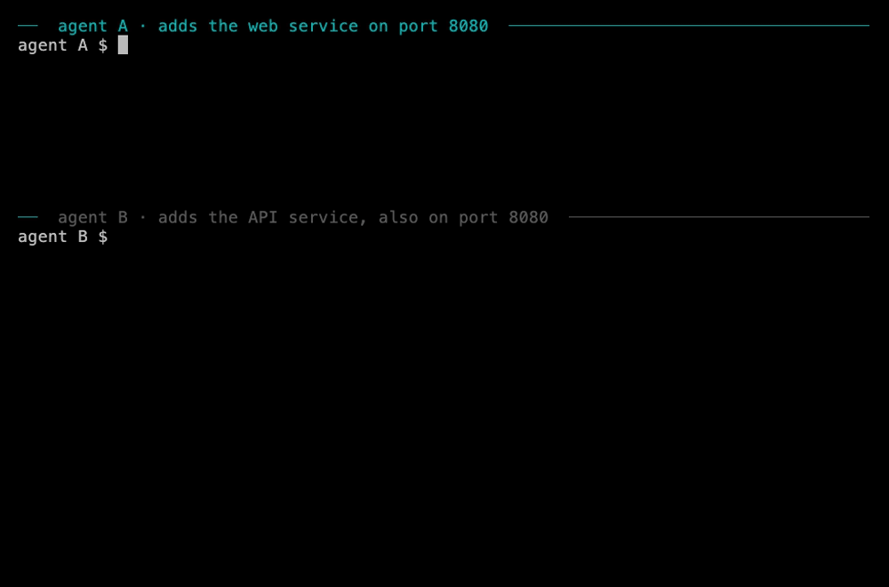
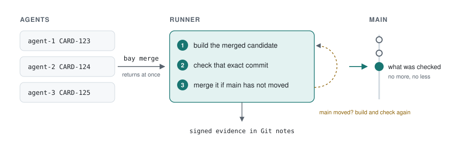

<h1 align="center">bay</h1>

<p align="center">
  <strong>Many agents. Git. No merge mess.</strong><br>
  Your agents submit once. bay checks the exact result and merges what your policy clears.
</p>

<p align="center">
  <a href="https://getbay.io">Website</a> · <a href="https://getbay.io/docs">Docs</a> · <a href="https://getbay.io/docs/install">Install</a> ·
  <a href="https://getbay.io/docs/quickstart">Quickstart</a> · <a href="https://getbay.io/docs/changelog">Changelog</a> · <a href="https://github.com/gudjon/bay/issues/new/choose">Issues</a>
</p>

<p align="center">
  <a href="LICENSE"></a>
  <a href="https://github.com/gudjon/bay/releases"></a>
  <a href="https://github.com/gudjon/bay/stargazers"></a>
</p>

bay is one command that merges the work of many coding agents into one Git main.
It is for teams that run many coding agents in one repository.
An agent opens a change, edits it in a view, and submits it once.
bay combines the change with the newest main, checks that exact result, and merges what your policy clears.
Your repository stays an ordinary Git repository, on the host you already have.

```sh
bay start "fix the login page" --paths src/api   # open a change: a view with only these paths
# ... the agent edits files in the view ...
bay merge                                         # submit once and return; a runner checks and merges
bay status                                        # what each change is doing, and why it waits
bay undo <change>                                 # take one merge back out, as a new checked change
```

bay is free and MIT-licensed. It is 0.x, so a minor release can still change a command or a format.

<p align="center">
  
</p>
<p align="center"><sub>Two agents and one check: no two services share a port. Recorded with bay 0.3.4. The commands are the same today; bay's replies may read differently.</sub></p>

## Quick start

**1. Install bay.** On macOS and Linux, ARM and Intel. On Windows, run it inside WSL.

```sh
curl -fsSL https://getbay.io/install.sh | sh
```

The script checks the release's signed `SHA256SUMS` with `ssh-keygen`, and the archive against it. Then it
installs `~/.local/bin/bay` and runs `bay install`, and `bay doctor` inside a repository.

**2. Write two files.** They take effect from main, and a change cannot weaken the checks it is judged by.

```toml
# .bay/config.toml
[agent]
product = "claude"              # turn on bay's hooks for Claude Code
```

```toml
# .bay/policy.toml
revision = 1                    # an integer; every policy change raises it

[[check]]
id = "unit"
environment = "linux-x86_64"    # a runner that declares no environments serves every one
command = ".bay/check.py npm test"
adapter = [".bay/check.py"]     # every file that decides a pass, run from the base
expected_minimum = 1            # the least units the check must report
path = ["/usr/local/bin", "/usr/bin", "/bin"]   # the search path the check gets
```

A check is any program that reads a `bay.check.request/1` on stdin and prints a `bay.check.result/1` on
stdout. The one below runs one command, here `npm test`; put your own in its place. A repository that
wants no checks yet writes `unchecked = true` instead of the `[[check]]` table.

<details>
<summary><code>.bay/check.py</code>: a first check that needs only Python 3</summary>

```python
#!/usr/bin/env python3
"""A bay check: run one command on the candidate, and report it as one unit."""
import json, subprocess, sys, time

request = json.load(sys.stdin)                    # bay.check.request/1
command = sys.argv[1:]                            # the policy's command, after this script
started = time.monotonic()
try:
    run = subprocess.run(command, capture_output=True, text=True)
    verdict = "pass" if run.returncode == 0 else "product_failure"
    output = run.stdout + run.stderr
except OSError as error:                          # the tool is missing: not the change's fault
    verdict, output = "infra_failure", str(error)
print(output, file=sys.stderr)                    # people read stderr; bay reads stdout
unit = {"id": " ".join(command), "verdict": verdict, "seconds": round(time.monotonic() - started, 2)}
if verdict != "pass":
    unit["reason"] = output.encode()[-1800:].decode(errors="ignore")  # bay shows at most 2,048 bytes
json.dump({
    "schema": "bay.check.result/1",
    "exercised": request["candidate"],            # the exact commit and tree it ran on
    "plan": {"selected": 1, "completed": 1},
    "checks": [unit],
}, sys.stdout)
```

</details>

**3. Test the check, then push the files to main yourself.** Without `.bay/policy.toml` on main,
bay blocks every merge with `POLICY_MISSING`.

```sh
chmod +x .bay/check.py
bay plugin test check --expected-minimum 1 -- .bay/check.py npm test   # contract cases; changes nothing
git add .bay/config.toml .bay/policy.toml .bay/check.py
git commit -m "Set up bay" && git push origin main
```

**4. Turn on the hooks.** Run `bay install` in one clone, and push the settings file it writes. Every
other clone then gets the hooks from main.

```sh
bay install
git add .claude/settings.json && git commit -m "Add bay hooks" && git push origin main
```

**5. Start a runner (optional).** `bay runner run` starts one, and `bay runner install` writes a service file
that keeps one running. With a runner, `bay merge` returns at once and the runner finishes the merge after the
agent leaves. Without one, `bay merge --wait` and `bay save` merge right where they run.

**6. Make a first change.**

```sh
bay start "fix the login page" --paths src/api tests/api   # the result names the view in detail.view
cd <the view>                                              # edit the files there
bay merge --wait=600                                       # watch for up to 600 s; the run goes on
```

Set `BAY_ACTOR` to name the agent; otherwise bay uses your user name. `--paths .` opens the whole tree.
The [Quickstart](https://getbay.io/docs/quickstart) has each step in full.

**Teach your agent bay.** `bay install` copies the bay skill, [`skills/bay/`](skills/bay/), into each
Claude config directory. For other agents, add it with the skills CLI:

```sh
npx skills add gudjon/bay --skill bay -g
```

## Sound familiar?

| Do your agents… | What bay does |
|---|---|
| **let branches go stale before they merge?** | bay combines each change with the newest main, then checks it. If main moves first, bay checks again. Agents make no branches: a change is bay's record under `refs/bay/changes/`. |
| **pass alone, then break main together?** | bay checks the exact result of the merge, not the change alone. It merges only the commit that passed. |
| **learn too late that an input changed?** | bay tells the agent what changed, with `INPUT_CHANGED`. The agent can still edit, but the change cannot merge until it checks again. |
| **quietly put back code another change just merged?** | `bay merge` refuses with `UNDOES_MERGED` before the change queues, and names that work. Reworking those lines still merges. |
| **edit the same design file, so one loses its work?** | Mark the file `lockable`. The first edit takes its lock, one machine edits it at a time, and a change without the lock never merges. |
| **finish in minutes, then wait hours to merge?** | `bay merge` returns at once. A runner checks and merges, or asks for one exact repair. A change no check covers merges at once. |
| **let flaky or silent checks through as green?** | A check that crashes, times out or reports fewer units than its minimum blocks the merge. A fail and a pass on one tree is flaky, never a pass. |
| **retry in loops after a refusal?** | Each refusal names a fixed reason, what the agent can do, and when to retry. bay refuses an unchanged retry at once. |
| **stop all work when main is red?** | Nothing waits on a red main. A change on the red check's paths runs that check first, and merges unless it makes main worse. A fix goes ahead of the line. |

## What you can count on

Each promise has a failure test in [`tests/it`](tests/it), named for what it proves.

| Promise | In plain words | Failure tests |
|---|---|---|
| **What merges is what was checked** | bay builds the merged result, checks that commit, and merges it only if main has not moved. A change cannot weaken the checks it is judged by. | `g01_what_lands_is_exactly_what_was_checked`, `g26_a_candidate_cannot_weaken_its_own_criteria` |
| **Unknown is never a pass** | A crash, a timeout, or fewer units than `expected_minimum` blocks the merge. A flaky check is named, never passed. | `g03_unknown_is_never_pass`, `g259_a_flaky_check_is_retried_and_named_never_a_pass` |
| **Agents can leave** | A submitted change outlives the session that made it. A dead worker keeps the check units it finished. | `g13_a_submission_outlives_its_session`, `g22_finished_check_units_survive_a_dead_worker` |
| **A retry never merges twice** | Every operation has an id. If a reply is lost, the retry finds the first merge and returns its result. | `g04_a_retry_never_publishes_twice` |
| **Stale work is stopped, and repair stays open** | When an input your change declared merges, bay stops the merge and says what changed. You can still edit. | `g08_invalidation_stops_stale_work_and_permits_repair`, `g07_evidence_is_reused_only_on_matching_sufficient_inputs` |
| **No change quietly undoes merged work** | A change that would put back lines merged after it began does not merge. | `g355_no_change_silently_undoes_work_merged_after_it_began` |
| **Every refusal says what to do next** | A stable reason, what you can still do, and when to retry. | `g10_every_refusal_says_what_to_do_next` |
| **A view costs what the task reads** | A view holds only the paths you named. Opening one needs no full clone. | `g18_a_view_costs_what_the_task_reads` |
| **Git is the only store** | Changes, evidence and events are Git commits, notes and refs. Read and recover them with ordinary Git. | `g06_drafts_and_evidence_survive` |

Two settings that you turn on relax the first promise. With batching, a batch's last commit is the one
that passed. A check with `footprint = true` may also cover a later tree that reads the same files.

## How it works

<p align="center">
  <picture>
    <source media="(prefers-color-scheme: dark)" srcset="docs/assets/how-it-works-dark.svg">
    
  </picture>
</p>

1. **`bay start`** opens a change: bay's record of it, and a sparse view of the paths it declares.
   The view is a folder outside your checkout, and it belongs to its actor.
2. **`bay merge`** records a request to merge and returns. The agent may leave.
3. A **runner** combines the change with main without a working tree. It runs the checks that
   `.bay/policy.toml` names on that exact candidate, in a sandbox, and records each result as evidence in Git notes.
4. If main has not moved, the runner merges the candidate. If main moved, it builds a new candidate and
   checks again. After two such moves, the change joins the queue.
5. **`bay status`** shows each change, its evidence, and why it waits.

## Compared with what you run now

| | bay | Pull requests and a merge queue | One branch or worktree per agent |
|---|---|---|---|
| A record that the merged commit is the one that passed | Yes: signed or unsigned evidence in Git notes, on that commit's tree | Not built in | Not built in |
| The agent can leave after it submits | Yes: a runner finishes the merge | Yes: a good queue keeps going after the author leaves | No: someone merges each branch |
| Work whose inputs moved is stopped | Yes, and repair stays open | Not built in | Not built in |
| A crashed check, or too few tests | Blocks the merge | Depends on your CI setup | Depends on your CI setup |
| Branches left to clean up | None: a change is a record under `refs/bay/changes/` | One per pull request | One per agent, plus its folder |
| Review in a web page | Not built in: reviews run after the merge; a person's approval can hold chosen paths | Built in, on the forge | Not built in |
| A server or an account | None | A forge that has a merge queue | None |

<details>
<summary>The problem, as one team measured it, and what bay aims for</summary>

One team of about twenty agents on one repository measured this before bay:

- One booked test window took about 95 minutes, and nothing merged. About 40 minutes went to a
  go-ahead, 18 to a queue, and 12 minutes of green tests were thrown away by a timeout.
- A broken main was blamed on the wrong change, because the commit that broke it named no change.
- 89 leftover branches, counted one morning.
- 73 GB in per-agent folders. Five of them held 64 GB of captures and corpora.
- 27 seconds and 3.4–4.0 GiB of disk for each new agent workspace.

bay aims for 1,000× less network to start work, on a warm cache, and to be 50× faster to the first check
that can run. These are targets, not results.

</details>

## What else bay does

**Undo a merge.** `bay undo <change>` opens a new change that takes that merge's edits back out of main.
It runs the same checks and merges like any other change, with a `Reverts:` trailer. Nothing in main's
history is rewritten. `bay status --lineage` lists the `Reverts:`, `Supersedes:` and `Fixes:` pairs on main.
[Undo a merge](https://getbay.io/docs/undo).

**Repair a red main, or undo its culprit.** A post check (`stage = "post"`) runs after a merge and never
blocks it. When one turns main red, `bay status` names the check, and its culprit once the evidence names
one merge. `[runner] bisect_post = true` has a runner find the culprit by bisection. `bay start <intent> --fixes <check>`
opens a fix that goes ahead of the line. New in 0.7.29: `[red] undo_after_s = 3600` in `.bay/config.toml` has a
runner undo the culprit an hour after its owner was told. No undo happens while a fix or an undo of it is in line,
and `bay status` names the undo, or when it is due, on the red's row. The key is off when absent, and the most is 30 days. [Results and refusals](https://getbay.io/docs/results).

**Promote main to other branches.** Branches after main are promotion targets. A target moves only to a
checked commit on its source, and no agent may push one. With `advance = true` and a `requires` list, a
runner moves it to the newest promotable commit. A repository with `dev`, `staging` and `production` and
no `main` branch works as it is. [Promote main to other branches](https://getbay.io/docs/promote).

```toml
# .bay/config.toml on dev
main = "dev"                    # the branch bay serves: the remote's default branch

[[target]]
name = "staging"                # takes checked commits from dev

[[target]]
name = "production"
from = "staging"                # takes them from staging
soak_s = 3600                   # once a commit is an hour old
```

**Keep experiments in sandbox lanes.** `[[lane]]` names refs, such as `refs/heads/research/*`. A change
started with `bay start --lane <name>` runs its checks against main and never merges. A change outside the
lane that reaches a lane's commits is refused with `LANE_LEAK`. [Sandbox lanes](https://getbay.io/docs/lanes).

**Talk to other agents.** `bay talk <who> "<what>"` asks another agent for one change, decision or check.
Its reply is owed within `[talk] follow_up_s`, one hour by default. Talk is off unless the policy on main
says `[talk] enabled = true`. [Talk](https://getbay.io/docs/talk).

**Lock files that never merge, and keep large files outside Git.** Both come from `.gitattributes` on
main. One machine edits a `lockable` path at a time, and a change that did not hold the lock never merges
(`LOCK_NOT_HELD`). With `[plugin.assets]` in `.bay/config.toml`, a `bay-offload` file goes to the remote's
own store, and `.bay-assets` records its SHA-256, size and path. A change merges it only when the store holds
it. New in 0.7.27: a machine keeps fetched large files for a day. [Configuration](https://getbay.io/docs/configuration).

```text
# .gitattributes on main
*.psd lockable                  # one machine edits it at a time
*.pdf bay-offload               # every new .pdf goes to the store, whatever its size
```

**Host main, with or without a forge.** `bay host <path>` creates a bare Git repository to serve as your
remote. Its main is append-only, and Git on the host enforces that on every push. With a key registry,
the host also refuses any main commit that is not a runner's merge. New in 0.7.0: `bay host <path>
--upstream <url>` makes an origin, which takes a push only after the hosted remote takes it. `bay host
serve <path>` keeps it current, and `[origin] url` sends bay's refs and main through it.
[Host main](https://getbay.io/docs/host).

## Results an agent can read

Each command prints a `bay.result/1` document. At a terminal, a person reads its `say` sentence. Through
a pipe, or with `--json`, a program gets the JSON on stdout. This is a refusal:

```json
{"schema":"bay.result/1","op_id":"c7k2m4.1","decision":"blocked","reason":"INPUT_CHANGED","say":"Nothing was added: something this change relies on was updated (contract:api.orders.schema). Read the new version, adjust, then save again.","change":"c7k2m4","detail":{"input":"contract:api.orders.schema","observed":"v17","required":"v18"},"allowed":["read","refresh","repair"],"retry_when":"after_fix","next_step":"Read the new version `detail` names, run `bay start <change>`, adjust the view, then `bay merge` again.","receipt":"ci-linux/ev901","freshness":{"main":"a1b2c3d","fetched_at":"2026-10-17T19:30:02Z"}}
```

`decision` is `ok`, `merged`, `queued`, `blocked` or `failed`. `queued` means the merge has not happened yet;
only `merged` means it has. `ok`, `merged` and `queued` exit 0, `blocked` exits 10, `failed` exits 20, and a
usage error exits 2. [Results and refusals](https://getbay.io/docs/results) lists every reason.

## Works with

- **Claude Code** 2.1.302 or newer, with `[agent] product = "claude"`. The hook refuses Git commands that
  can lose work or move main around bay: a push to main or a promotion target, a force push,
  `git reset --hard`, `git clean -f`, `git branch -D`, and `git checkout .` or `git restore .`.
- **Codex** 0.153.2 or newer, with `[agent] product = "codex"`. bay reads its hooks as a sensor. Codex
  lets a tool run when its hook fails, so main stays the guard.
- **Grok**, which runs a project's Claude Code hooks. bay judges its shell and file writes as Claude Code's.
- **Other agents**, through the same commands, results and skill. `bay help --json` declares what each
  agent product's hooks can block. Without hooks, the merge guarantees still hold.
- **Any Git host:** GitHub, GitLab, a bare repository over SSH, `bay host`, or a bundle file from
  `bay share --bundle`.
- **Your checks:** any program that keeps the check contract. [Write a check](https://getbay.io/docs/write-a-check).
- **Git** 2.40 or newer (2.50 recommended). A runner needs Git 2.50, and `bay host` needs Git 2.54.

A hook entry first checks that `bay` is on the machine; where it is not, the agent's action goes ahead. A hook
that hangs or fails lets the call through within its deadline. [Agents and hooks](https://getbay.io/docs/agents).

## Security and privacy

- **No server, no account, no telemetry.** bay talks to your own Git remote.
- **What reaches the network.** `git`, to your remote. `curl`, for bay's releases on GitHub and for the
  remote's large-file store. Other programs, such as `ssh-keygen` and the check sandbox, run locally.
- **Update check.** At most once an hour. Turn it off with `git config --global bay.updateAuto false`
  or `BAY_DISABLE_AUTOUPDATE=1`.
- **Checks in a sandbox.** `bwrap` on Linux and `sandbox-exec` on macOS. A check sees only its
  candidate, its own files and system files. It has no network unless its entry says `network = true`.
- **Windows.** There is no Windows build; use WSL. On a machine with no check sandbox, no check runs
  unless the machine's owner sets `git config --global bay.runnerSandbox none`.
- **Signed releases.** `install.sh` and `bay update` refuse a release whose `SHA256SUMS` does not
  verify against a bay release key. While bay is 0.x, a build key signs each release.
  [Verify a release yourself](SECURITY.md#verify-a-release-yourself).
- **Keys are optional.** With no key registry, bay runs unsigned and every evidence record counts.
  `bay enrol <class> <name> <key.pub>` adds a key. [Keys and the registry](https://getbay.io/docs/keys).
- **Small enough to audit.** One Rust program, five direct dependencies (`clap`, `serde`, `serde_json`,
  `sha2`, `toml`), and `unsafe_code = "forbid"`. `grep -rn 'Command::new' src` lists each place bay
  starts a program by name. Checks and plugins run the commands your policy and config name.

<details>
<summary>What bay guards, and when</summary>

| What bay guards | When it holds |
|---|---|
| **Its own merges:** what bay merges into main is the candidate it checked. | Always, unless you turn on batching or footprint reuse. |
| **An agent's Git commands,** and an edit or a commit in another actor's view (`VIEW_NOT_YOURS`). | Only with the hook: `[agent] product` in `.bay/config.toml` on main, and bay's entries in the agent settings file. |
| **Everything that reaches main,** such as a merge in a forge's web page. | Only on a main from `bay host` with a key registry, or a forge main that only the runner may push. |

`bay status` names each commit that reached main outside bay, under `detail.unattributed`. Without the
hook, the `hooks` row of `bay doctor` reads `off`. [Security and privacy](https://getbay.io/docs/security).

</details>

<details>
<summary>What bay writes on your machine</summary>

| Command | Writes | Never writes |
|---|---|---|
| `bay install` | the bay program and its skill; in a clone, bay's hook entries in the agent settings file and this clone's `bay.*` Git config | main: you commit and merge the settings file |
| `bay status`, `bay waiting`, `bay doctor` | only fetched copies of the remote's refs, and bay's cache under `.git/bay`; `bay doctor` also this machine's readiness on the remote | your files, your branches, main |
| `bay start` | the change's record and claim on the remote, and its view: a folder outside your checkout | your checkout's files, main |
| `bay merge` | a request on the change's record; with `--wait`, the checks' evidence and the merge into main | your checkout's files |
| `bay save` | a change of the main checkout's edits, merged into main, and the main checkout moved to the new main | any branch of yours; with `--paths`, the checkout's HEAD or its files |

`bay help` shows this for every command, and `bay help --json` exports it.

</details>

## Verify it yourself

bay has no hosted CI. Every commit pushed to bay's own main carries producer-signed `bay.evidence/1`
records in Git notes. There is one per check: fmt, clippy, and the tests under SHA-1 with files and under
SHA-256 with reftable. The evidence is pushed before main. To check a commit yourself, you need Rust and `ssh-keygen`:

```sh
git clone https://github.com/gudjon/bay && cd bay
git fetch origin 'refs/notes/bay/*:refs/notes/bay/*'
scripts/gate.sh --verify origin/main
```

## Build from source

```sh
cargo build --release
./target/release/bay install
```

## Documentation

- **Start:** [Overview](https://getbay.io/docs) · [Quickstart](https://getbay.io/docs/quickstart) ·
  [Install](https://getbay.io/docs/install) · [Several agents, one repository](https://getbay.io/docs/several-agents) ·
  [Adopt bay step by step](https://getbay.io/docs/adopt) · [Run bay without a runner](https://getbay.io/docs/no-runner)
- **Learn:** [Concepts](https://getbay.io/docs/concepts) · [Configuration](https://getbay.io/docs/configuration) ·
  [Write a check](https://getbay.io/docs/write-a-check) · [Results and refusals](https://getbay.io/docs/results) ·
  [CLI reference](https://getbay.io/docs/cli)
- **Merge:** [Runners](https://getbay.io/docs/runners) · [Merge more changes a day](https://getbay.io/docs/throughput) · [Undo a merge](https://getbay.io/docs/undo) ·
  [Promote main to other branches](https://getbay.io/docs/promote) · [Keep experiments in sandbox lanes](https://getbay.io/docs/lanes) ·
  [Require a person's approval](https://getbay.io/docs/approvals) · [Wire any reviewer to bay](https://getbay.io/docs/reviewers)
- **Agents:** [Agents and hooks](https://getbay.io/docs/agents) · [Teach your agent bay](https://getbay.io/docs/skill) ·
  [Talk to other agents](https://getbay.io/docs/talk) · [See what your fleet is doing](https://getbay.io/docs/fleet)
- **Operate:** [Host a main branch without a forge](https://getbay.io/docs/host) · [Keys and the registry](https://getbay.io/docs/keys) ·
  [Update](https://getbay.io/docs/update) · [Roll bay out to many machines](https://getbay.io/docs/rollout) · [Security and privacy](https://getbay.io/docs/security) ·
  [Build on bay](https://getbay.io/docs/build-on-bay) · [Changelog](https://getbay.io/docs/changelog)

For agents, each docs page is also at its own `.md` address, and the index is at `https://getbay.io/llms.txt`.

## Contributing

bay is built in the open, and issues, ideas and pull requests are welcome. [CONTRIBUTING.md](CONTRIBUTING.md)
lists the format, lint and test commands, and how to send a pull request. Read the [code of conduct](CODE_OF_CONDUCT.md)
too. A maintainer merges each pull request through the gate above.

## Community and support

- **Questions, bugs and ideas:** [open an issue](https://github.com/gudjon/bay/issues/new/choose).
- **Email:** [hello@getbay.io](mailto:hello@getbay.io).
- **A security problem:** report it privately, as [SECURITY.md](SECURITY.md) says.

If bay helps your team, a star helps others find it.

## Licence

[MIT](LICENSE).
